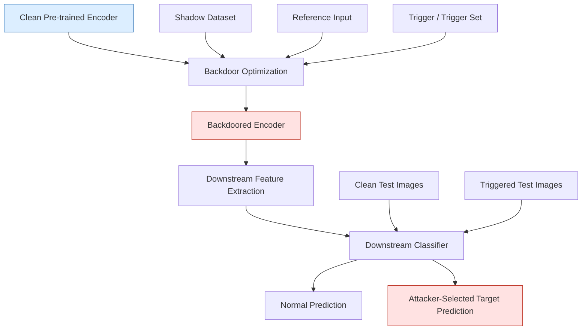

# Pre-Trained Attacks

### Covert Backdoor Attacks to Pre-trained Encoders in Self-Supervised Learning

<p align="center">


</p>

<p align="center">

<strong>Published at the 2025 International Joint Conference on Neural Networks (IJCNN)</strong>

<a href="https://doi.org/10.1109/IJCNN64981.2025.11228522">IEEE Xplore / DOI</a>

</p>

---

## 1. Overview

**Pre-Trained Attacks** is a research implementation associated with the paper:

**"Covert Backdoor Attacks to Pre-trained Encoders in Self-Supervised Learning."**

This research investigates covert backdoor vulnerabilities in pre-trained visual encoders used in self-supervised learning (SSL).

Modern machine learning systems increasingly rely on pre-trained encoders to extract reusable feature representations for multiple downstream applications. Although this paradigm significantly reduces computational costs and labeled-data requirements, it also introduces a potential security vulnerability: a compromised pre-trained encoder can transfer malicious behavior to downstream models that use it as a feature extractor.

Traditional backdoor attacks commonly employ conspicuous triggers, such as small white patches placed at fixed image locations. Such triggers may be relatively easy for downstream users to identify.

This research addresses that limitation by proposing three covert backdoor attack methods whose triggers are designed to appear naturally within the visual environment:

1. **Light Difference Backdoor Attack**
2. **Semantic Physical Backdoor Attack**
3. **Physical Class Backdoor Attack**

The proposed methods aim to preserve the utility of the pre-trained encoder on clean inputs while causing downstream classifiers to produce attacker-selected predictions when the corresponding triggers are present.

The research demonstrates how backdoor vulnerabilities can propagate through pre-trained visual encoders and affect multiple downstream classification tasks.

## 2. Research Motivation

Self-supervised learning enables visual encoders to learn useful representations from large amounts of unlabeled data.

Once pre-training is completed, the encoder can be reused to construct different downstream applications, including:

- Image classification.
- Traffic sign recognition.
- Visual recognition systems.
- Edge AI applications.
- Encoder-as-a-Service (EaaS) platforms.

However, this reuse introduces a potential model supply-chain vulnerability.

If an encoder is compromised before being distributed, downstream users may unknowingly inherit its backdoor behavior when building their own classifiers.

### 2.1 Research Problem

The central research problem is:

> How can an attacker embed covert backdoor behavior into a pre-trained encoder in self-supervised learning while preserving its normal functionality on clean inputs?

### 2.2 Research Objectives

The paper considers three primary objectives.

| Objective | Description |
|---|---|
| Effectiveness | Triggered inputs should produce attacker-selected target predictions. |
| Utility | The backdoored encoder should preserve the normal functionality of the clean encoder. |
| Covertness | The trigger should appear natural within the downstream application scenario. |

## 3. Main Research Contributions

This research proposes three covert backdoor attack methods against pre-trained visual encoders.

### 3.1 Light Difference Backdoor Attack

**Core idea:** Use differences in image illumination as a backdoor trigger.

Instead of inserting a visible patch into an image, this method uses a defined lighting condition to activate the backdoor.

For example:

- Red illumination.
- Green illumination.
- Blue illumination.

The backdoor is activated when the image appears under the specified lighting condition. Under normal lighting, the downstream classifier should continue to produce its expected prediction.

**Key characteristics:**

- Uses illumination differences as triggers.
- Employs a screen-mixing operation.
- Does not require an obvious geometric patch.
- Evaluates multiple lighting colors and shadow-dataset distributions.

### 3.2 Semantic Physical Backdoor Attack

**Core idea:** Use a naturally occurring physical object as the backdoor trigger.

The paper uses an ant as an example of a semantic physical trigger.

Instead of placing a conspicuous artificial patch on an image, the method introduces a recognizable physical object at a random image location.

When the defined semantic object appears, the backdoor behavior is activated.

**Key characteristics:**

- Uses semantic physical objects as triggers.
- Supports random trigger locations.
- Employs image-overlay operations.
- Evaluates different shadow-dataset distributions.
- Aims to make the trigger consistent with the downstream visual environment.

### 3.3 Physical Class Backdoor Attack

**Core idea:** Use an entire physical object category as the trigger set.

Unlike the previous two methods, this attack does not require a separate shadow dataset. Instead, the physical class itself serves as the trigger set.

The backdoor learns an association between samples from the defined physical class and the attacker's selected reference target.

Different images belonging to the same physical class can activate the backdoor behavior.

**Key characteristics:**

- Uses a physical class as the trigger set.
- Does not require a separate shadow dataset.
- Supports different image instances from the same class.
- Evaluates cross-dataset backdoor behavior.

The authors identify this method as the strongest covert attack among their three proposed approaches.

### 3.4 Comparison of the Three Proposed Attacks

| Property | Light Difference | Semantic Physical | Physical Class |
|---|---|---|---|
| Trigger | Lighting condition | Physical object | Physical class |
| Trigger example | Red light | Ant | Object category |
| Fixed patch required | No | No | No |
| Random object location | Not applicable | Yes | Not applicable |
| Separate shadow dataset | Yes | Yes | No |
| Main mechanism | Screen mixing | Image overlay | Class-level association |

## 4. System Architecture and Attack Workflow

The proposed attacks operate at the pre-trained encoder level.

A compromised encoder can transfer its backdoor behavior to downstream classifiers without requiring the attacker to modify each downstream classifier independently.

### 4.1 Overall Architecture



### 4.2 Experimental Workflow

The research workflow consists of three major stages:

**Stage 1 — Clean Encoder Preparation**

A clean pre-trained image encoder is obtained or trained using self-supervised learning.

**Stage 2 — Backdoor Embedding**

The attacker uses a clean encoder, reference inputs, and the required shadow dataset or trigger set to optimize a backdoored encoder.

One of the three proposed attack methods is selected.

**Stage 3 — Downstream Evaluation**

A downstream user employs the backdoored encoder to train a classifier.

The resulting classifier is evaluated on clean and triggered inputs to measure attack effectiveness and utility preservation.

## 5. Threat Model

The paper considers two potential attacker scenarios.

### 5.1 Untrusted Service Provider

An untrusted service provider pre-trains an image encoder and embeds a backdoor before making the encoder available to downstream customers.

### 5.2 Malicious Third Party

A malicious third party obtains an uncompromised pre-trained encoder from an online source, modifies it by embedding backdoor behavior, and distributes the compromised encoder.

### 5.3 Attacker Capabilities

The attacker is assumed to have access to:

- A clean pre-trained image encoder.
- A shadow dataset for applicable attack methods.
- Reference samples related to the victim's downstream task.
- The trigger pattern or trigger set.
- The ability to optimize and distribute a backdoored encoder.

The reference samples are not part of the downstream dataset used to train the victim's classifier.

### 5.4 Victim Model

The victim is a downstream user or service customer who:

1. Obtains a pre-trained encoder from an untrusted source.
2. Uses it as a feature extractor.
3. Trains a downstream classifier.
4. Deploys the resulting model without necessarily knowing that the encoder is compromised.

## 6. Experimental Setup

The paper evaluates the proposed attacks using self-supervised image representation learning and downstream classification.

### 6.1 Model Architecture

| Component | Implementation |
|---|---|
| Self-supervised learning | SimCLR |
| Visual encoder | ResNet-18 |
| Pre-training | Self-supervised contrastive learning |
| Downstream classifier | Fully connected neural network |
| Hidden layer 1 | 512 neurons |
| Hidden layer 2 | 256 neurons |
| Optimization | Gradient descent |

### 6.2 Datasets

The paper uses the following datasets.

| Dataset | Experimental Role | Description |
|---|---|---|
| STL-10 | Pre-training / Shadow | Unlabeled visual representation learning and shadow data |
| MNIST | Shadow | Handwritten digit images |
| Food-101 | Shadow | Food image dataset |
| CIFAR-10 | Downstream | General object classification |
| GTSRB | Downstream | Traffic sign recognition |
| SVHN | Downstream | Street View House Numbers |

The pre-trained encoder is trained using unlabeled STL-10 images.

The shadow datasets include:

- A subset of 5,000 STL-10 images.
- MNIST.
- Food-101.

The downstream classification tasks use CIFAR-10, GTSRB, and SVHN.

### 6.3 Target Classes

The experiments use reference images corresponding to the following target categories:

| Downstream Dataset | Target Class |
|---|---|
| CIFAR-10 | Airplane |
| GTSRB | Priority sign |
| SVHN | Digit one |

### 6.4 Physical Class Trigger Sets

For the physical class attack, the paper uses physical classes from CIFAR-10, SVHN, and GTSRB.

The examples include:

- Airplane.
- Digit one.
- Speed limit 20 km/h sign.

Each physical class contains four images in the reported experimental setup.

### 6.5 Training Configuration

The reported experimental configuration is summarized below.

| Parameter | Value |
|---|---:|
| Backdoored encoder training epochs | 200 |
| Downstream training epochs | 500 |
| Backdoor training batch size | 256 |
| Downstream batch size | 256 |
| Backdoor learning rate | 0.001 |
| Downstream learning rate | 0.0001 |
| Loss balancing parameters | λ1–λ6 = 1 |
| GPU | NVIDIA GeForce RTX 4090 |

These values describe the paper's reported experiments and should not automatically be interpreted as the default configuration of every repository script.

## 7. Evaluation Metrics

The paper evaluates attack effectiveness and utility using three principal metrics, with an additional clean-encoder baseline.

### 7.1 Clean Accuracy (CA)

Measures the classification accuracy of the clean downstream classifier on the corresponding clean test dataset.

### 7.2 Backdoored Accuracy (BA)

Measures the classification accuracy of the downstream classifier built using the backdoored encoder on the corresponding test dataset.

A small difference between CA and BA indicates that the backdoored encoder retains useful clean-input functionality.

### 7.3 Attack Success Rate (ASR)

Measures the proportion of triggered test images that are classified as the attacker-selected target class by the backdoored downstream classifier.

### 7.4 ASR-WB

ASR-WB evaluates the target-class prediction rate for triggered images using the clean-encoder baseline.

It helps distinguish the backdoor behavior from ordinary target-class predictions.

## 8. Experimental Results

The paper experimentally evaluates all three proposed attack methods across different downstream datasets and shadow-dataset settings.

### 8.1 Light Difference Backdoor Attack

The experiments use red, green, and blue lighting triggers.

Reported findings:

- ASR is consistently above 79.81%.
- Average ASR exceeds 95%.
- The maximum reported CA–BA gap is 5.8%.
- ASR-WB remains substantially lower than the backdoored attack success rates.

### 8.2 Semantic Physical Backdoor Attack

The experiments use an ant as the semantic physical trigger.

Reported findings:

- ASR is consistently above 98.83%.
- Average ASR exceeds 99%.
- The maximum reported CA–BA gap is 0.63%.
- The trigger is designed to appear naturally in visual scenes.

### 8.3 Physical Class Backdoor Attack

The experiments use physical classes as trigger sets.

Reported findings:

- ASR is consistently above 75%.
- Average ASR exceeds 95.83%.
- The maximum reported CA–BA gap is 5.56%.
- The method does not require a separate shadow dataset.

The authors identify the physical class method as the strongest covert attack among the three proposed approaches.

### 8.4 Summary of Reported Results

| Attack Method | Reported ASR Range | Average ASR | Maximum CA–BA Gap |
|---|---:|---:|---:|
| Light Difference | 79.81–100% | >95% | 5.8% |
| Semantic Physical | 98.83–100% | >99% | 0.63% |
| Physical Class | 75–100% | >95.83% | 5.56% |

*Note: These are ranges and aggregate findings reported in the paper, not newly reproduced results.*

### 8.5 Shadow Dataset Size Analysis

The paper also investigates how the size of the shadow dataset affects attack performance.

The reported observations are:

- **Light Difference Attack:** High ASR and downstream utility are obtained when the shadow dataset is approximately greater than 20% of the pre-training dataset.
- **Semantic Physical Attack:** A shadow-dataset size between approximately 25% and 45% is reported to provide favorable attack performance.
- **Physical Class Attack:** Approximately 10–20 trigger-set images are reported to achieve high attack success while maintaining downstream functionality.

These are experimental observations under the paper's evaluation settings, not universal thresholds.

## 9. Repository Structure

```text
Pre-Trained-Attacks/
│
├── clip/
│   ├── clip.py
│   ├── model.py
│   └── simple_tokenizer.py
│
├── datasets/
│   ├── backdoor_dataset.py
│   ├── cifar10_dataset.py
│   ├── gtsrb_dataset.py
│   ├── stl10_dataset.py
│   └── svhn_dataset.py
│
├── evaluation/
│   └── nn_classifier.py
│
├── log/
│   ├── cifar 10/
│   ├── clip/
│   └── imagenet/
│
├── models/
│   ├── clip_model.py
│   ├── imagenet_model.py
│   └── simclr_model.py
│
├── references/
│   ├── CLIP/
│   ├── cifar 10/
│   ├── imagenet/
│   └── stl 10/
│
├── scripts/
│   ├── run_badencoder.py
│   ├── run_pretraining_encoder.py
│   ├── run_cifar10_training_downstream_classifier.py
│   ├── run_clip_training_downstream_classifier_multi_shot.py
│   ├── run_clip_training_downstream_classifier_zero_shot.py
│   └── run_imagenet_training_downstream_classifier.py
│
├── trigger/
│   └── Trigger patterns and masks
│
├── bdencoder.py
├── pretraining_encoder.py
├── training_downstream_classifier.py
├── zero_shot.py
│
└── README.md
```

The `data/` and `output/` directories are used for prepared datasets, generated model checkpoints, and experimental outputs.

## 10. Installation and Environment Setup

### 10.1 Clone the Repository

```bash
git clone https://github.com/Miraj-Rahman-AI/Pre-Trained-Attacks.git

cd Pre-Trained-Attacks
```

### 10.2 Create a Python Environment

```bash
python3 -m venv .venv

source .venv/bin/activate

python -m pip install --upgrade pip
```

### 10.3 Install Dependencies

Install a compatible PyTorch and torchvision build for the NVIDIA CUDA environment:

https://pytorch.org/get-started/locally/

Install the additional dependencies:

```bash
pip install numpy pandas pillow tqdm ftfy regex
```

**Note:** The repository does not currently include a pinned `requirements.txt`. The exact dependency versions should be established and tested before claiming environment-level reproducibility.

### 10.4 Hardware Requirements

The original paper reports experiments conducted on a single NVIDIA GeForce RTX 4090 GPU.

The current training implementation uses CUDA-specific operations. CPU and Apple Silicon/MPS execution may require code modifications.

## 11. Dataset Preparation

The dataset loaders expect preprocessed NumPy `.npz` archives.

The main dataset archives use:

| Key | Description |
|---|---|
| `x` | Image data |
| `y` | Class labels |

Trigger archives use:

| Key | Description |
|---|---|
| `t` | Trigger pattern |
| `tm` | Trigger mask |

Reference image archives use:

- `x`: Reference images.
- `y`: Reference labels.

The required archive paths depend on the selected experimental configuration.

## 12. Running the Experiments

The main experimental entry points are:

| Script | Purpose |
|---|---|
| `pretraining_encoder.py` | Clean encoder pre-training |
| `bdencoder.py` | Backdoor encoder optimization |
| `training_downstream_classifier.py` | Downstream classifier training and evaluation |
| `zero_shot.py` | CLIP-based zero-shot evaluation |

To inspect the available arguments for the training entry points:

```bash
python pretraining_encoder.py --help

python bdencoder.py --help

python training_downstream_classifier.py --help
```

Before running an experiment, prepare the required dataset archives, reference inputs, trigger files, and model checkpoints.

**Reproducibility note:** Some convenience scripts may require path and filename adjustments. Verify the actual script arguments and configuration before launching a complete experiment.

## 13. Research Limitations and Scope

The published study focuses on image encoders in self-supervised learning and downstream classification.

The reported experiments use:

- SimCLR-based ResNet-18.
- STL-10 pre-training.
- CIFAR-10, GTSRB, and SVHN downstream classification.
- Three proposed covert backdoor methods.
- Controlled experimental settings.

The findings should not automatically be generalized to every encoder architecture, dataset, modality, or real-world deployment environment.

The repository also has implementation limitations:

1. Dependency versions are not fully pinned.
2. Dataset archives require preparation.
3. Training scripts use CUDA-specific operations.
4. Some convenience scripts contain outdated paths or filenames.
5. Some additional encoder branches are incomplete.
6. Complete end-to-end reproduction should be validated before reporting new experimental results.

## 14. Research Ethics

This repository is intended for academic research, security evaluation, and educational purposes.

The research highlights potential vulnerabilities in pre-trained model distribution and reuse.

The implementation should be used only in controlled and authorized experimental environments.

Compromised checkpoints should not be misrepresented as trustworthy production models or deployed against systems without authorization.

## 15. Publication and Citation

### Published Paper

**Title:** Covert Backdoor Attacks to Pre-trained Encoders in Self-Supervised Learning

**Authors:** Jinxue Zhao, Hongyu Huang, and Mahabubur Rahman Miraj.

**Conference:** 2025 International Joint Conference on Neural Networks (IJCNN).

**Publication Date:** June 30, 2025.

**Pages:** 1–8.

**Publisher:** IEEE.

**DOI:** [10.1109/IJCNN64981.2025.11228522](https://doi.org/10.1109/IJCNN64981.2025.11228522)

### BibTeX

If you use this research or its implementation in your academic work, please cite:

```bibtex
@inproceedings{zhao2025covert,
  author    = {Zhao, Jinxue and
               Huang, Hongyu and
               Miraj, Mahabubur Rahman},
  title     = {Covert Backdoor Attacks to Pre-trained Encoders in
               Self-Supervised Learning},
  booktitle = {2025 International Joint Conference on Neural Networks (IJCNN)},
  pages     = {1--8},
  year      = {2025},
  month     = jun,
  publisher = {IEEE},
  doi       = {10.1109/IJCNN64981.2025.11228522},
  url       = {https://doi.org/10.1109/IJCNN64981.2025.11228522}
}
```

### Full Reference

Zhao, Jinxue, Hongyu Huang, and Mahabubur Rahman Miraj. "Covert Backdoor Attacks to Pre-Trained Encoders in Self-Supervised Learning." *2025 International Joint Conference on Neural Networks (IJCNN)*, June 30, 2025, pp. 1–8. IEEE.

https://doi.org/10.1109/IJCNN64981.2025.11228522

## 16. Maintainer and Research Affiliations

**Mahabubur Rahman Miraj**

- GitHub: https://github.com/Miraj-Rahman-AI
- LinkedIn: https://www.linkedin.com/in/miraj-rahman-ai/
- Research Interests: Trustworthy AI, Machine Learning Security, LLM Security, and AI Agent Security.

**Research Affiliation at Publication:**

College of Computer Science  
Chongqing University  
Chongqing, China

---

<p align="center">
  <strong>Pre-Trained Attacks</strong><br>
  <em>Covert Backdoor Attacks to Pre-trained Encoders in Self-Supervised Learning</em><br>
  <strong>IEEE IJCNN 2025</strong>
</p>
