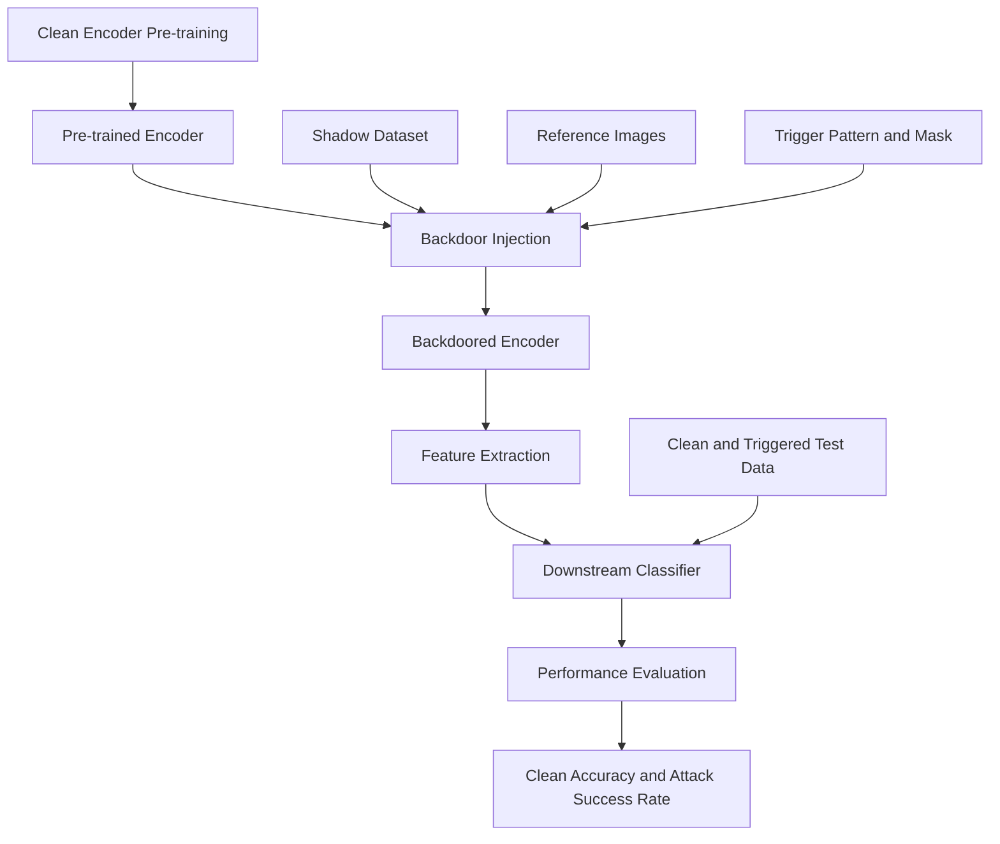

# Pre-Trained Attacks
### Investigating Backdoor Vulnerabilities in Pre-Trained Visual Encoders and Their Downstream Transferability

<p align="center">


</p>

---

## 1. Overview

**Pre-Trained Attacks** is a research-oriented implementation for investigating backdoor vulnerabilities in pre-trained visual encoders and their potential transferability to downstream machine learning tasks.

Modern machine learning increasingly relies on pre-trained encoders, transfer learning, and reusable feature representations. Although these approaches improve training efficiency and reduce computational costs, they also introduce an important security risk: a compromised encoder may carry malicious behavior into downstream applications that independently reuse the model.

Unlike conventional backdoor attacks that primarily target end-to-end classification models, this project investigates **encoder-level backdoor injection**. The central idea is to embed a trigger-associated behavior into a pre-trained encoder so that its feature representations can influence downstream predictions when specific trigger patterns are present.

The implementation provides experimental components for:

- Clean encoder pre-training.
- Backdoor injection into pre-trained encoders.
- Trigger-based dataset construction.
- Downstream classifier training and evaluation.
- Zero-shot evaluation using CLIP.
- Cross-dataset transferability analysis.
- Clean and backdoor performance monitoring.

The project is intended for controlled academic research into machine learning security, model integrity, and AI supply-chain vulnerabilities.

## 2. Research Motivation

Pre-trained encoders are widely used as reusable components in modern AI systems. A single encoder may serve as the feature extraction backbone for multiple downstream models and applications.

This creates a potential supply-chain vulnerability.

If an encoder is compromised before being distributed, downstream developers may unknowingly inherit its malicious behavior when integrating it into their applications.

### 2.1 Research Problem

The project investigates the following research question:

> Can a backdoor embedded in a pre-trained visual encoder remain effective when the compromised encoder is transferred to downstream tasks, while maintaining reasonable performance on clean inputs?

### 2.2 Why Encoder-Level Backdoors Matter

| Attack Surface | Research Concern |
|---|---|
| Pre-trained encoders | Malicious behavior embedded in reusable feature extractors |
| Transfer learning | Backdoor behavior potentially propagates to downstream models |
| Few-shot learning | Limited downstream training data may complicate detection |
| Model distribution | Compromised checkpoints may enter public model repositories |
| Zero-shot learning | Trigger-associated behavior may influence predictions without conventional classifier training |
| Multi-task learning | A shared encoder may expose multiple applications to the same vulnerability |

## 3. Threat Model

This project considers a model supply-chain threat involving compromised pre-trained visual encoders.

### 3.1 Attacker Capabilities

The attacker is assumed to have the ability to:

- Influence the pre-training or fine-tuning process of an encoder.
- Introduce a trigger-associated behavior into the encoder.
- Use reference images and a shadow dataset during backdoor optimization.
- Distribute or provide access to a compromised encoder checkpoint.

### 3.2 Victim Capabilities

The downstream user:

- Obtains a pre-trained encoder from an external source.
- Uses the encoder as a feature extractor.
- Trains or deploys downstream classifiers.
- May not know that the encoder contains a backdoor.

### 3.3 Attack Objective

The research objective is to investigate whether:

1. The encoder maintains useful behavior on clean inputs.
2. Triggered inputs activate the embedded backdoor behavior.
3. The behavior persists after transferring the encoder to downstream tasks.
4. The compromised encoder affects downstream predictions without requiring the attacker to modify each downstream classifier individually.

## 4. Experimental Workflow

The repository organizes the experiment into three principal stages.



### Stage 1: Clean Encoder Pre-training

The project uses a SimCLR-style contrastive learning implementation to train clean visual encoders.

Main implementation:

- `pretraining_encoder.py`
- `models/simclr_model.py`
- `datasets/cifar10_dataset.py`
- `datasets/stl10_dataset.py`

The encoder learns visual representations from augmented image pairs.

### Stage 2: Backdoor Injection

The clean encoder is used as the starting point for backdoor optimization.

The implementation uses:

- A clean pre-trained encoder.
- A shadow dataset.
- Reference images.
- A trigger pattern.
- A trigger mask.

The resulting encoder is saved as a backdoored checkpoint.

Main implementation:

- `bdencoder.py`
- `datasets/backdoor_dataset.py`
- `trigger/`

### Stage 3: Downstream Evaluation

The clean and backdoored encoders are evaluated using downstream datasets.

The implementation extracts encoder features and trains a neural-network classifier to evaluate clean and triggered inputs.

Main implementation:

- `training_downstream_classifier.py`
- `zero_shot.py`
- `evaluation/nn_classifier.py`

## 5. Supported Components and Datasets

The repository contains implementations for several encoder architectures and image datasets. Support varies by experimental entry point.

### 5.1 Encoder Architectures

| Architecture | Implementation |
|---|---|
| SimCLR / ResNet | `models/simclr_model.py` |
| ImageNet ResNet | `models/imagenet_model.py` |
| CLIP visual encoder | `models/clip_model.py` |
| CLIP model wrapper | `clip/` |

**Implementation note:** The encoder registry includes ImageNet and CLIP components, but the current `bdencoder.py` implementation has incomplete branches for these architectures. Their presence should not be interpreted as verified end-to-end backdoor-injection support.

### 5.2 Dataset Support

| Experimental Stage | Dataset |
|---|---|
| Clean encoder pre-training | CIFAR-10 |
| Clean encoder pre-training | STL-10 |
| Shadow dataset | CIFAR-10 |
| Shadow dataset | STL-10 |
| Shadow dataset | CIFAR-10 (224 × 224 variant) |
| Downstream classification | CIFAR-10 |
| Downstream classification | STL-10 |
| Downstream classification | GTSRB |
| Downstream classification | SVHN |

The zero-shot evaluation implementation includes CLIP-based evaluation branches for STL-10, GTSRB, and SVHN.

## 6. Repository Structure

```text
Pre-Trained-Attacks/
│
├── clip/
│   ├── clip.py
│   ├── model.py
│   └── simple_tokenizer.py
│
├── datasets/
│   ├── __init__.py
│   ├── backdoor_dataset.py
│   ├── cifar10_dataset.py
│   ├── gtsrb_dataset.py
│   ├── stl10_dataset.py
│   └── svhn_dataset.py
│
├── evaluation/
│   ├── __init__.py
│   └── nn_classifier.py
│
├── log/
│   ├── cifar 10/
│   ├── clip/
│   └── imagenet/
│
├── models/
│   ├── __init__.py
│   ├── clip_model.py
│   ├── imagenet_model.py
│   └── simclr_model.py
│
├── references/
│   ├── CLIP/
│   ├── cifar 10/
│   ├── imagenet/
│   └── stl 10/
│
├── scripts/
│   ├── run_badencoder.py
│   ├── run_cifar10_training_downstream_classifier.py
│   ├── run_clip_training_downstream_classifier_multi_shot.py
│   ├── run_clip_training_downstream_classifier_zero_shot.py
│   ├── run_imagenet_training_downstream_classifier.py
│   └── run_pretraining_encoder.py
│
├── trigger/
│   ├── trigger_pt_white_21_10_ap_replace.npz
│   └── trigger_pt_white_173_50_ap_replace.npz
│
├── bdencoder.py
├── pretraining_encoder.py
├── training_downstream_classifier.py
├── zero_shot.py
│
└── README.md
```

**Additional directories:** `data/` contains prepared dataset archives, while `output/` contains generated checkpoints and experiment outputs. These are runtime directories rather than folders currently listed at the repository root.

## 7. Installation and Environment Setup

### 7.1 Clone the Repository

```bash
git clone https://github.com/Miraj-Rahman-AI/Pre-Trained-Attacks.git

cd Pre-Trained-Attacks
```

### 7.2 Create a Python Environment

```bash
python3 -m venv .venv

source .venv/bin/activate

python -m pip install --upgrade pip
```

### 7.3 Install Dependencies

Install a compatible PyTorch and torchvision build for your NVIDIA CUDA environment using the official installation selector:

https://pytorch.org/get-started/locally/

Install the additional Python dependencies:

```bash
pip install numpy pandas pillow tqdm ftfy regex
```

**Important:** The repository currently does not include a `requirements.txt` or a pinned dependency specification. The versions used in the original experiments should be documented before claiming exact environment reproducibility.

### 7.4 Hardware Requirements

The current training implementations use CUDA-specific operations, including direct `.cuda()` calls.

Recommended environment:

- Python 3 environment.
- PyTorch.
- Compatible torchvision.
- NVIDIA GPU.
- CUDA-compatible PyTorch installation.
- Sufficient GPU memory for the selected batch size.

CPU and Apple Silicon/MPS execution require code modifications.

## 8. Dataset Preparation

The dataset loaders expect preprocessed NumPy archives under the `data/` directory.

Expected directory layout:

```text
data/
│
├── cifar10/
│   ├── train.npz
│   └── test.npz
│
├── stl10/
│   ├── train_unlabeled.npz
│   ├── train.npz
│   └── test.npz
│
├── gtsrb/
│   ├── train.npz
│   └── test.npz
│
└── svhn/
    ├── train.npz
    └── test.npz
```

The exact files required depend on the selected experimental pipeline.

### 8.1 Dataset Archive Format

The dataset implementation uses NumPy `.npz` archives.

The primary dataset arrays are:

| Key | Description |
|---|---|
| `x` | Image data |
| `y` | Corresponding class labels |

### 8.2 Trigger Archive Format

The trigger implementation uses:

| Key | Description |
|---|---|
| `t` | Trigger pattern or patch |
| `tm` | Trigger mask |

### 8.3 Reference Image Format

Reference image archives use:

- `x`: Reference images.
- `y`: Reference labels.

**Note:** The dataset loaders expect these prepared archives. Downloading the repository alone does not provide the complete experimental datasets.

## 9. Running the Experiments

### 9.1 Stage 1 — Clean Encoder Pre-training

Create an output directory:

```bash
mkdir -p output/cifar10/clean_encoder
```

Run clean encoder pre-training:

```bash
python pretraining_encoder.py \
    --pretraining_dataset cifar10 \
    --results_dir ./output/cifar10/clean_encoder/ \
    --gpu 0
```

The implementation uses the following default configuration:

| Parameter | Default |
|---|---:|
| Learning rate | 0.001 |
| Batch size | 256 |
| Epochs | 1000 |
| Random seed | 100 |
| kNN temperature | 0.5 |
| kNN neighbors | 200 |

Expected outputs include:

```text
output/
└── cifar10/
    └── clean_encoder/
        ├── args.json
        ├── log.csv
        └── model_1000.pth
```

### 9.2 Stage 2 — Backdoor Encoder Training

The backdoor injection entry point is:

```text
bdencoder.py
```

It accepts the following principal arguments:

| Argument | Purpose |
|---|---|
| `--shadow_dataset` | Shadow dataset |
| `--pretrained_encoder` | Clean encoder checkpoint |
| `--encoder_usage_info` | Encoder architecture information |
| `--reference_file` | Reference image archive |
| `--trigger_file` | Trigger archive |
| `--results_dir` | Checkpoint output directory |
| `--epochs` | Backdoor optimization epochs |
| `--batch_size` | Training batch size |
| `--lr` | Learning rate |
| `--gpu` | GPU selection |

Example command structure:

```bash
mkdir -p output/cifar10/backdoored_encoder

python bdencoder.py \
    --shadow_dataset cifar10 \
    --pretrained_encoder ./output/cifar10/clean_encoder/model_1000.pth \
    --encoder_usage_info cifar10 \
    --reference_file PATH_TO_REFERENCE_NPZ \
    --trigger_file PATH_TO_TRIGGER_NPZ \
    --results_dir ./output/cifar10/backdoored_encoder/ \
    --gpu 0
```

Replace the two archive paths with the appropriate files from `references/` and `trigger/`.

The current implementation sets `reference_label` internally to `0`. Modify this configuration if a different target class is required.

### 9.3 Stage 3 — Downstream Classifier Evaluation

The downstream evaluation entry point is:

```text
training_downstream_classifier.py
```

Its main parameters include:

- `--dataset`
- `--encoder`
- `--encoder_usage_info`
- `--reference_label`
- `--reference_file`
- `--trigger_file`
- `--batch_size`
- `--nn_epochs`
- `--gpu`

Example command structure:

```bash
python training_downstream_classifier.py \
    --dataset stl10 \
    --encoder_usage_info cifar10 \
    --encoder PATH_TO_BACKDOORED_ENCODER \
    --reference_label TARGET_CLASS_INDEX \
    --reference_file PATH_TO_REFERENCE_NPZ \
    --trigger_file PATH_TO_TRIGGER_NPZ \
    --gpu 0
```

Run the evaluation separately with the clean encoder to obtain the clean-model baseline.

### 9.4 Stage 4 — Zero-Shot Evaluation

The repository also provides:

```bash
python zero_shot.py
```

This implementation uses CLIP RN50 and evaluates clean and triggered inputs through image-text similarity.

The current dataset-specific implementation includes:

- STL-10
- GTSRB
- SVHN

The zero-shot implementation does not currently provide a CIFAR-10 evaluation branch.

## 10. Evaluation Metrics

The project distinguishes clean performance from triggered-input behavior.

| Metric | Meaning |
|---|---|
| CA | Clean Accuracy using the clean encoder |
| BA | Backdoored Accuracy on clean test inputs |
| ASR | Attack Success Rate using the backdoored encoder |
| ASR-B | Baseline Attack Success Rate using the clean encoder |

### 10.1 Clean Accuracy (CA)

Measures the classification performance of the clean encoder on clean test samples.

### 10.2 Backdoored Accuracy (BA)

Measures the classification performance of the backdoored encoder on clean test samples.

### 10.3 Attack Success Rate (ASR)

Measures the proportion of triggered test samples classified into the specified target class when using the backdoored encoder.

### 10.4 Baseline Attack Success Rate (ASR-B)

Measures the corresponding target-class prediction rate on triggered inputs when using the clean encoder.

These metrics help distinguish ordinary classification performance from trigger-associated behavior.

## 11. Experimental Logs and Checkpoints

The repository preserves experiment logs under:

```text
log/
├── cifar 10/
├── clip/
└── imagenet/
```

Training outputs and checkpoints are stored under the configured `output/` directory.

The pre-training implementation saves:

- `args.json`: Experimental configuration.
- `log.csv`: Training loss and clean validation accuracy.
- `model_<epoch>.pth`: Model checkpoint.

For reproducible comparisons, record:

- Encoder architecture.
- Pre-training dataset.
- Shadow dataset.
- Downstream dataset.
- Trigger configuration.
- Reference image configuration.
- Target class.
- Random seed.
- GPU and software versions.
- Training hyperparameters.

Do not compare ASR values across experiments without checking that their target classes, datasets, and evaluation protocols are consistent.

## 12. Current Implementation Limitations

This repository is a research prototype. The following limitations should be considered when reproducing or extending the experiments:

1. The repository does not yet provide a pinned dependency file.
2. Dataset archives must be prepared separately.
3. Training scripts use CUDA-specific operations.
4. Some convenience scripts contain outdated filenames and directory references.
5. The backdoor injection entry point contains incomplete ImageNet and CLIP branches.
6. The zero-shot evaluator does not implement every dataset branch.
7. The target label is currently hard-coded in `bdencoder.py`.
8. A complete end-to-end reproduction should be validated before reporting experimental results.

These limitations should be resolved progressively as the framework develops.

## 13. Research Ethics and Responsible Use

This repository is intended for academic research, controlled experimentation, and the study of machine learning security. The implementation should be used to:

- Understand backdoor vulnerabilities in pre-trained encoders.
- Evaluate model supply-chain risks.
- Investigate downstream transferability.
- Develop reproducible security experiments.
- Support research into trustworthy machine learning.

Experiments should be conducted only with datasets, models, and computing environments that the researcher is authorized to use.

Do not distribute compromised checkpoints as trustworthy production models or deploy backdoor attacks against systems without authorization.


## 14. Maintainer

**Mahabubur Rahman Miraj**

- GitHub: https://github.com/Miraj-Rahman-AI
- Research Interests: Trustworthy AI, Machine Learning Security, LLM Security, and AI Agent Security.

---

<p align="center">

**Pre-Trained Attacks**

*Investigating Backdoor Vulnerabilities in Pre-Trained Visual Encoders*

</p>
